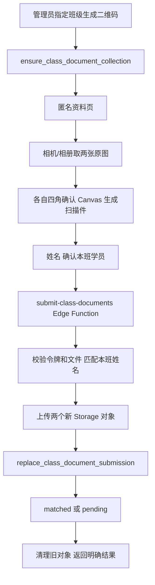

# Code Wiki：当前代码结构与调用链

更新时间：2026-10-12。核对基线：`eb1df86`。本 Wiki 按源码描述当前状态；历史文档里的计划不自动成为现行实现。

## 1. 阅读顺序与边界

先读 [交接入口](HANDOVER.md)、[需求与差异](REQUIREMENTS.md)、[项目约定](../AGENTS.md)。数据库在线状态和部署见交接入口对应手册，使用方法见 [用户手册](USER_GUIDE.md)。

系统是 Netlify React SPA + Supabase 后端，没有随 Netlify 发布的常驻 Node 业务服务器。Vite 环境变量构建时注入，所有 VITE_* 值浏览器可读；Service Role Key 只能留在服务端，不得写进前端或 Git。

## 2. 目录与职责

```text
src/
  main.jsx                         React 挂载与样式
  App.jsx                          匿名资料路由/私有应用分流
  PrivateApp.jsx                   其余路由和三套 AuthProvider
  components/DangerDeleteModal.jsx  危险删除二次确认
  contexts/                        学员/普通管理员/超管 Context
  lib/
    supabase.js                    三角色客户端、学员 session 读取
    siteUrls.js                    对外二维码/超管 URL
    lazyWithRetry.js                动态模块失败刷新一次
    resilientDownload.js           下载、停滞计时、重试、离线、取消
    excelTemplateFilter.js         Excel 模板工具
    constants.js、*.json            表单常量、地址等静态数据
  pages/
    Login.jsx、Register.jsx         学员/管理员登录、学员注册
    StudentProfile.jsx             档案与证件上传
    EnrollConfirmation.jsx         报名编排及状态缓存
    ClassDocumentUpload.jsx        匿名两份 A4 上传
    admin/
      AdminRegister.jsx            普通管理员注册
      AdminDashboard.jsx           班级/学员/资料三 Tab
      ClassManagement.jsx          班级、两类二维码、提交数
      EnrollmentManagement.jsx     报名审核、报考类型、旧导出
      ClassDocumentManagement.jsx  预览、替换、纠错、删除、ZIP UI
      ClassDocumentArchive.js      ZIP 会话、下载队列、打包
    super/                         SuperLogin / SuperDashboard / AllStudents
    tools/
      documentScanner.js           Canvas A4 透视扫描
      ExcelTemplateFilterTool.jsx  Excel 模板筛列页
public/
  stuIm.xlsx                       报名导出模板（正式资源）
  _redirects、_headers             Netlify SPA 与缓存配置
supabase/
  migrations/                      历史结构、RLS、RPC（不能盲目重放）
  functions/submit-class-documents/ 匿名上传 Edge Function
  functions/send-capacity-report/   容量报告 Edge Function
  schedule_capacity_report.sql     容量巡检计划 SQL
tests/                             弱网下载/归档测试
docs/                              交接、需求、操作、专项文档
```

磁盘上可能另有演示 HTML、备份、相机测试页，是否属于仓库以 `git ls-files` 为准。正式路由没有 `/camera-upload-test`，不能把本地旧试验页当成已部署功能。

## 3. 路由与登录隔离

| 路由 | 页面/行为 | 身份要求 |
| --- | --- | --- |
| `/class-documents/:accessToken` | ClassDocumentUpload，App 直接引入 | 匿名；后端校验令牌 |
| `/` | 有学员 session 转档案，否则登录 | 无 |
| `/login`、`/login?role=admin` | 学员/普通管理员登录 | 无 |
| `/admin/login` | 重定向 `/login?role=admin` | 无 |
| `/register`、`/admin/register` | 学员/普通管理员注册 | 后端决定是否允许 |
| `/student/profile` | StudentProfile | 学员 ProtectedRoute |
| `/enroll/:classId` | EnrollConfirmation | 页面内处理登录/档案/报名 |
| `/admin/dashboard` | AdminDashboard | 管理员 session + admins 校验 |
| `/super/login` | SuperLogin | 密码及前端演示验证码步骤 |
| `/super/dashboard`、`/super/students` | 超管控制台/全量学员 | 操作由后端校验；当前无统一 ProtectedRoute 包裹 |
| `/tools/excel-template-filter` | 模板筛列 | 本地文件处理 |

`App` 对 `/class-documents/` 单独分流，不启动三套认证。其他路由进入懒加载 PrivateApp，依次包裹三个 Provider。**StudentProfile、EnrollConfirmation 当前也使用 lazyWithRetry**；4 月文档里的“直接加载”是当时措施，不是当前事实。修改这里需回归手机相册返回，不可只看构建。

`lazyWithRetry` 首次导入失败写 sessionStorage 标记并刷新；再次失败提示页面版本更新，无无限重试。

### 三个客户端

[supabase.js](../src/lib/supabase.js) 目前均读同一 `VITE_SUPABASE_URL`、`VITE_SUPABASE_ANON_KEY`，使用 sessionStorage：

| 使用方 | client | 存储键 |
| --- | --- | --- |
| 学员 | supabase | `sb-<项目 ref>-auth-token` |
| 普通管理员 | supabaseAdmin | `student-system-admin-token` |
| 超管 | supabaseSuper | `student-system-super-token` |

历史 `.env.example` 的 VITE_SUPABASE_SUPER_URL / VITE_SUPABASE_SUPER_ANON_KEY 当前未在此读取，不能靠它们切换超管后端。`siteUrls.js` 读取 VITE_APP_SITE_URL、VITE_SUPER_SITE_URL，缺省用当前 origin。

- AuthContext 尽力同步读取已有学员 user，再 getSession 更新，始终渲染 children。
- AdminAuthContext 恢复 session、登录、查 admins 各有 15 秒 Promise 超时，始终渲染 children；没有管理员记录则登出并报错。
- SuperAuthContext 单独管理超管 session；它与学员 Context 并非所有请求都有超时。
- AdminDashboard 等管理员认证后再查 admins，失败转登录；旧文档的 `!loading && children` 不再适用。

## 4. 报名与档案调用链

`ClassManagement → buildAppUrl('/enroll/:classId') → EnrollConfirmation → StudentProfile → profiles / enrollments`。

EnrollConfirmation 读班级、登录注册、查档案与报名，用 sessionStorage 缓存状态；结束流程可退出并刷新。StudentProfile 用 react-hook-form 管理表单，保存后为指定班级写 pending 报名。

| 项目 | 身份证/证件照 | 两份 A4 资料 |
| --- | --- | --- |
| 页面 | StudentProfile | ClassDocumentUpload |
| 登录 | 学员登录 | 无需登录 |
| 处理 | Canvas 压缩，兼容分支可传原图 | 手动四角 Canvas 透视 JPEG |
| 选图限制 | 15 MB | 12 MB；服务端也校验 |
| Storage | student-documents | 私有 class-submission-documents |
| 数据 | profiles 图片 URL | class_document_submissions 对象路径 |
| 保存 | 学员 client | Edge Function + service_role 专用替换 RPC |

档案上传组件在主组件外定义避免重挂；草稿保存 `localStorage student_profile_draft_<userId>`，上传恢复记录在 sessionStorage，调试日志在 localStorage。`?uploadDebug=1` 仅是档案上传调试开关。压缩最大边按设备分支为 1280/1600，失败回退原图，旧文档统一 1920 不是当前值。

## 5. 资料收集调用链



### 5.1 令牌、相机和扫描

`ensure_class_document_collection(target_class_id)` 核验班级所有者，每班一条 collection，重复生成沿用 access_token，无过期字段/撤销按钮。

网页相机 `getUserMedia` 请求后置与理想高分辨率；黄框仅引导，没有边缘检测门槛。优先 ImageCapture.takePhoto，失败用视频 Canvas 截帧；回退系统相机为 `<input type=file accept=image/* capture=environment>`，具体选择器依设备而异。

CornerConfirm 四角顺序左上、右上、右下、左下。createScan 使用透视映射和 20×28 三角网格，输出纵向 1654×2339、JPEG 质量 0.94，无 OCR、去阴影、黑白增强或可靠失焦检测。扫描在前端完成，服务端不再次裁切。

### 5.2 提交、覆盖与待核对

FormData 为 accessToken、studentName、criminalRecord、healthDeclaration。两份扫描件齐全及姓名确认后 POST `/functions/v1/submit-class-documents`。页面未先显示班级详情或预校验令牌，令牌错误在提交时才拒绝。

函数用服务端 Service Role 查 collection，按本班 `enrollments → profiles.real_name` 去空白/转小写匹配；仅一个匹配才填 enrollment_id，零个或多个均 pending，无模糊匹配。对象路径：

```text
class-submission-documents/<class_id>/<submission_id>/criminal-record.jpg
class-submission-documents/<class_id>/<submission_id>/health-declaration.jpg
```

每次先上传随机新 submissionId 的两张图，再 RPC 原子替换数据库记录；匹配资料按 enrollment_id 找旧记录，pending 按同班 name_key 找旧 pending。数据库失败清理新对象，成功尝试清理返回的旧路径。两服务无跨事务，旧文件清理失败当前不改变成功结果，应巡检；学员重交要求两份，用户端无历史版本。

### 5.3 后台管理

ClassDocumentManagement 用 supabaseAdmin 查名下 classes、enrollments、submissions，matched 按 enrollment_id 映射，pending 单列。

- 预览使用 600 秒签名 URL；单份下载直接 Storage.download，未接入 ZIP 弱网工具。
- 替换：Canvas 转 JPEG，在原对象 upsert，再更新 updated_at；管理员无四角编辑步骤。
- 纠错：`resolve_class_document_submission`，下拉只列本班尚无 matched 资料学员。RPC 能处理重复关联，但 UI 不暴露已有资料学员。
- 删除：直接 `.delete().eq('id', submission.id).select('id')`，校验返回行再清两个路径；清理失败明确提示“记录已删除，但图片文件清理失败”。

`delete_class_document_submission` RPC 保留但当前 UI 不用。历史 SQL `SELECT s INTO row_variable` 把复合记录塞首列 UUID 导致错误，修复为 `SELECT s.* INTO`；纠错 RPC 同样需修复版本。

### 5.4 全班 ZIP

`ClassDocumentManagement → prepareClassArchive → downloadClassArchive → downloadWithRetry → generateClassArchive`。

仅取匹配当前班级报名的资料，输出 `班级/姓名/姓名+无犯罪记录.jpg`、`姓名+身体健康申明.jpg`；非法字符换下划线，pending 不进入。同姓名目标路径未做 id 消歧，存在覆盖风险。

resilientDownload：签名请求 60 秒、现代流每次收数据重置 90 秒空闲计时、最多 4 次尝试、离线等待/取消，每次重签有效一小时 URL；无流能力旧浏览器正文回退上限 10 分钟。

ClassDocumentArchive：以提交 id/更新时间/路径缓存完整文件；先 2 并发，弱网后余下队列降 1；失败只补缺失文件，非 Range 字节续传。全齐后 JSZip STORE 流生成 Blob，释放源文件缓存，保留成品供再次保存。刷新/切班/切 Tab 离开资料页清空内存。

详细测试与限制见 [ZIP 专项](CLASS_DOCUMENT_ZIP_DOWNLOAD.md)。此改造不包含旧报名导出和单份下载。

## 6. 普通管理员与旧导出

ClassManagement 支持创建、列表、两类二维码和删除，删前查报名数，非空拒绝；当前无班级编辑界面，不能笼统写已具备完整 CRUD。

EnrollmentManagement 先取自己班级 id，再查报名，支持 pending/approved/rejected 审核、报考类型修改和密码重置。邮箱通过 get_user_emails，失败回退档案联系邮箱。普通管理员“删除学员”实际只删 enrollments，不等于注销全局账号。

| 操作 | 产物 |
| --- | --- |
| 下载报名资料 | 点击检查档案完整性，读取 public/stuIm.xlsx；ZIP 含 stu/stuIm.xlsx 和 stu/stuPicture/证件号码.后缀 |
| 下载身份证 | jsPDF 合成正反面 PDF，多项再 ZIP |
| 下载题库账号 | 学员题库账号.xlsx，依据报名报考类型等生成 |
| 模板筛列 | 本地按表头映射输出，不写业务库 |

旧报名导出抓图失败会跳过，成功生成 ZIP 不代表照片齐全。细节见 [导出完整性](EXPORT_COMPLETENESS_CHECK_20260618.md)、[Excel 导出](EXCEL_EXPORT_IMPLEMENTATION.md)、[题库账号](EXAM_TYPE_AND_QUESTION_ACCOUNT_EXPORT.md)。

## 7. 超管及危险操作

| 模块 | 主要 RPC |
| --- | --- |
| 管理员列表/统计/救援 | get_all_admins、get_admin_class_stats、find_lost_super_data、rescue_lost_classes |
| 无效账号 | get_zombie_users、delete_zombie_user、delete_zombie_users_batch |
| 管理员删除/密码 | delete_admin_by_super、reset_user_password |
| 全量学员 | get_all_students_overview、force_delete_student、force_delete_students_batch、reset_student_password |

创建管理员通过 supabaseSuper.auth.signUp 后写 admins，可能切换会话并要求超管重登，不是隔离的服务端 Admin API。前端写部分 super_audit_logs，不等于完整可靠审计。

SuperLogin 仍含固定账号判断、模拟验证码、首次初始化分支，不能称真实邮件二次验证，固定值不抄入文档。DangerDeleteModal 只作交互确认，不能替代授权。

83e7989 修复 enrollments.user_id/profile_id CASCADE；全局用户删除会影响其他班级，Storage 清理须看在线 RPC 和实际对象，不凭提示文案判断。

## 8. 数据关系与维护边界

auth.users 关联 profiles/admins；classes.admin_id 指向 Auth user；enrollments 关联班级、用户、档案；collections 每班一条令牌；submissions 的 enrollment_id 可空。管理员表 id 与 Auth user id 不可混用，get_admin_class_stats 内有映射。

资料 RLS 按班级所有者，Storage 按路径首段班级 id 授权。资料 RPC 为 SECURITY INVOKER，匿名替换仅授 service_role，不应“统一改 DEFINER”。资料 enrollment_id 和 resolved_by 用 ON DELETE SET NULL，删除报名后可能保留无关联 matched 记录，需巡检。

历史 SQL 有宽权限、救援和一次性清理，源码不是线上权限充分证据。按数据库手册核验在线定义、执行角色、RLS 与迁移台账，不要重放全部 SQL。

排查顺序：先定位角色/入口与当前版本，再区分认证、JS chunk、图片解码、扫描、上传、存储下载阶段。修复须记录 SHA、后端依赖与验证，更新 [STATUS.md](../STATUS.md)，不要仅在聊天留结论。
